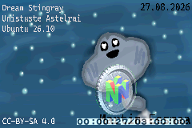

# GBA/AGB Aging Test programs

Written, hacked, analyzed, researched & documented by Martin Eesmaa.

Initial date: 25.10.2026

This test software was used within factory checking process as Nintendo authorized repair centers and to ensure correct operation of all units are tested successfully.

Requirements:

- **AGB Aging Cartridge / TEST PROGRAM Version 1.0, 7.0, 7.1, 9.0 or 10.0 ROM file (mandatory, legal copy)**
- Raster/pixel graphics to edit: GIMP, YY.CHR-NET, Aseprite or any preffered raster graphics editor
- GBA emulator: MesenCE (recommended), please note that almost all emulators of GBA may fail.

## Modding

You are welcome to mod the software aging by replacing text fonts, graphics, edit Mode background via tilemaps and map.

Best to view/emulate/analyze/edit/mod/debug is to use MesenCE emulator.

| Data | Program ROM address | Type | Bytes used |
| --- | --- | --- | ---- |
| 1st test RGB555 image (240x160) | `$19864` 7.0 | Direct color | 76800 bytes |
| 2nd test RGB555 image (240x160) | `$2C464` 7.0 | Direct color | 76800 bytes |
| 3rd test RGB555 image (240x160) | `$3F064` 7.0 | Direct color | 76800 bytes |
| 4th test RGB555 image (240x160) | `$51C64` 7.0 | Direct color | 76800 bytes |
| White & black bars RGB555 test (240x160) | `$64864` 7.0 | Direct color | 76800 bytes |
| Horizontal RGB555 image (240x160) | `$77D70` 1.0   `$83340` 7.0   `$834EC` 7.1   `$84278` 9.0   `$84330` 10.0 | Direct color | 76800 bytes |
| Raw image (240x160) | `$96140` 7.0 | 8bps | 38400 bytes |
| Another raw image (240x160) | `$9F940` 7.0 | 8bps | 38400 bytes |
| Vertical RGB555 image (160x256) | `$A8F40` 7.0 | Direct color | 81920 bytes |
| Donkey Kong 64 golden key | `$BCF60` 7.0 | 4 bps | 2048 bytes |
| Blue headphones sprite | `$BD780` 7.0 | 4 bps | 2048 bytes |
| Nintendo 64 coin sprite | `$BE180` 7.0 | 8 bps | 4096 bytes |
| Banana with N64 logo | `$BF380` 7.0 | 8 bps | 4096 bytes |
| Slingshot sprite | `$C0580` 7.0 | 8 bps | 4096 bytes |
| Watermelon box | `$C1780` 7.0 | 8 bps | 2048 bytes |
| Penguins tiles | `$C3100` 7.0 & `$C3DC0` 7.0 | 8 bps | 2752 bytes, total 5504 bytes |
| Time | `$C48A0` 7.0 | 4 bps | 384 bytes |
| Miscellaneous tiles | `$C4A20` 7.0 | 4 bps | 32768 bytes |
| Multi layers backgrounds | `$CCE50` 7.0 | 8 bps | 32768 bytes |
| Five bunch sprites | `$D527C` 7.0 | 8 bps | 32768 bytes |
| Donkey Kong Advance logo | `$DD6AC` 7.0 | 4 bps | 32768 bytes |
| Mario heads with miscellaneous icons | `$E5ADC` 7.0 | 8 bps | 32768 bytes |
| Initial Nintendo screen tiles | `$101C68` 7.0 | 4 bps | 19232 bytes |

| Sounds | Program ROM address | Format | Bytes used |
| --- | --- | --- | ---- |
| Aging Beeps | `$107950-10797F`, `$1079C8-1079F7`, `$107A40-107A6F`, `$107AB8-$107AE7` 7.0 | Sequence | Each 48 bytes, total 192 bytes |
| Additional beeps | `$107BB8-107BF7` 7.0 | Sequence | 64 bytes |
| Aging Music | `$11A03B-1215A5` 7.0 | Music 8 ch? | 30059 bytes |

| Maps | Program ROM address | Data used where | Bytes used |
| --- | --- | --- | ---- |
| Miscellaneous | `$EDF0C`, `$EE7DC`, `$EF0AC`, `$EF97C` 7.0 | Miscellaneous tiles | 8192 bytes (4x) |
| RGB lights only | `$F024C`, `$F0B1C`, `$F13EC` 7.0 | Miscellaneous tiles | 6144 bytes (3x) |
| Multisets | `$F1CBC`, `$F2E08`, `$F3F54`, `$F61A0` 7.0 | Multi layers backgrounds | 1/2: 4096 bytes, 3: 8192 bytes, 4: 2048 bytes (total: 18432 bytes) |
| Multisets #2 | `$F6A6C`, `$F74AC` 7.0 | Donkey Kong Advance logo, Five bunch sprites | 1: 2412 bytes, 2: 8192 bytes (total: 10604 bytes) |
| Colorsets | `$FDF44`, `$FE814`, `$FF0E4` 7.0 | Miscellaneous tiles, Mario heads with miscellaneous icons | 6144 bytes (3x) |
| End test | `$FF254`, `$FFB24`, `$1003F4-$1005F3` 7.0 | Miscellaneous tiles | 1/2: 2048 bytes, 3: 512 bytes used (total: 2560 bytes) |
| Pre-start test screen | `$106788` 7.0 | Initial Nintendo screen tiles | 2048 bytes |

## Test results

My own custom horizontal RGB555 image from GBA AGING version 7.0:

More coming soon...

- 2026 Martin Eesmaa
