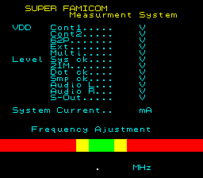
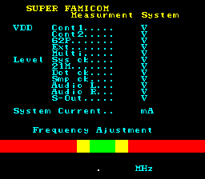

# SNES Aging Test programs

Written, hacked, analyzed, researched & documented by Martin Eesmaa.

Initial date: 03.10.2026

This test software was used within Nintendo's Uji factory in Japan during manufacturing of Super Famicom. v1.00 was produced date in 1990 and later versions were also updated in early 1990s.

Requirements:

- **Super Famicom Aging Program V1.00 or V1.02 original SNES/SFC ROM file (mandatory)**
- Raster/pixel graphics to edit: GIMP, YY.CHR-NET, Aseprite or any preffered raster graphics editor
- Map editing: M8TE (Mode 3 & 7) or/and M1TE2 (Mode 1, even also accepts Mode 2 BG2 only and Mode 0 BG4 for 2bps only)
- SNES emulator: MesenCE (recommended), snes9x or bsnes (alternative you can also use physical console with like SD2SNES)

Here are my hacks/modding can do Super Famicom Aging version 1.00 and 1.02:

## SNES Pro Action Replay codes

If you want boot into Super Famicom Measurement System menu, activate using Pro Action Replay codes:

**v1.00:**

```text
0083774C
008378CF
008379AE
```

**v1.02:**

```text
0083744C
008375D6
008376B0
```

The CPU location address of v1.00 is: **$00AECF** or v1.02: **$00B0D6**.

After that it should take you into this, result of **v1.00 Measurement System menu**:



**v1.02 Measurement System menu**:



Alternatively, IPS patch file to boot into measurement system: v1.00: [SHVC-AGING-MSv100](patches/SHVC-AGING-MSv100.ips) or version 1.02 [SHVC-AGING-MSv102](patches/SHVC-AGING-MSv102.ips)

If you want to bypass basic tests to ignore errors via old emulators/physical consoles to start anyways Mode background tests, then you can activate:

**v1.00:**

```text
0083774C
0083782A
00837999
```

**v1.02:**

```text
0083744C
008375F9
0083769B
```

The CPU location address of v1.00 is: **$00992A** or version 1.02: **$009BF9**.

Alternatively, IPS patch file to bypass basic tests: v1.00: [SHVC-AGING-BYP-v100](patches/SHVC-AGING-BYP-v100.ips) or v1.02: [SHVC-AGING-BYP-v102](patches/SHVC-AGING-BYP-v102.ips)

Note: The audio is out of sync when you bypass basic tests.

## Modding

You are welcome to mod the software aging by replacing text fonts, graphics, edit Mode background via tilemaps and map.

Best to view/emulate/analyze/edit/mod/debug is to use MesenCE emulator.

To edit tilesets with maps for Mode 1 software editor: M1TE2, Mode 3/7 editor: M8TE

Please note: You must have a tileset, a map and palette all together with M1TE2 or M8TE software editor.

| Data | Program ROM address | Type | Bytes used |
| --- | --- | --- | ---- |
| Texts | `$10000` | 2bps | 8192 bytes 1.00 <br> 16384 bytes 1.02 |
| Sprites | `$12000` 1.00 <br> `$14000` 1.02 | 4bps | 8192 bytes |
| Big sprites | `$14000-15FFF` 1.00 <br> `$16000-17FFF` 1.02 | 4bps | 8192 bytes |
| Mode 3 tilesets | `$8000-BFFF` | 8bps | 16384 bytes |
| Music SPC | `$18000-1A115` | Music | 8470 bytes |
| Palettes | `$2B5A-2C59` (Mode 0 only), `$16B00-16BFF`, `$16800-169FF` (Mode 3 & 7 only) 1.00 <br> `$2D81-2E80` (Mode 0 only), `$1A700-1A7FF`, `$1A400-1A5FF` (Mode 3 & 7 only) 1.02 | Color | 256/512 bytes, total 1024 bytes |
| Mode 7 rotation | `$3809-4348` 1.00 <br> `$3A10-454F` 1.02 | Animation keys | 2880 bytes |

Unused data partitions: Another Mode 3 tilesets from `$C000-FFFF` (16384 bytes, v1.00/1.02) & alternative palette `$16A00-16AFF` (1.00) / `$1A600-1A6FF` (1.02) of 256 bytes

---

| Mode/object maps | Program ROM address | Bytes |
| --- | --- | --- |
| 0 (only Layer 4) | `$4800-4FFF` (MODE 0 WHITE TEXT), `$5000-57FF` (BLUE TEXT), `$5800-$5FFF` (RED TEXT), `$6000-$67FF` (GREEN TEXT) | Each screen texts has 2048 bytes, it makes total 8192 bytes |
| 0 (1st-4th) sprite | `$1B1C`, `1B3F`, `1B62`, `1B9B` 1.00 (16x16) <br> `$1DD9`, `1DFD`, `1E1C` 1.02 (32x32) | 1 byte + extra byte for rotation (00, 40, 80, A0, C0), total 8 bytes 1.00 / 6 bytes 1.02 |
| 0 (priority OAM rotation) | `$1BB2` 1.00 <br> `$1E42` 1.02 | 1 byte |
| OBJTEST background color | `$1C3C` 1.00 <br> `$1EBD` 1.02 | 1 byte |
| OBJTEST flip screen (X,Y,TILE_ADDRESS,OAM) | `$1D64-1D7B` 1.00 <br> `$1FD7-1FF2` 1.02 | 24 bytes 1.00 / 28 bytes 1.02 |
| 1 | `$1B000-1B7FF` (Layer 1), `$1B800-1BFFF` (Layer 2) | Each mode layer is 2048 bytes, total 4096 bytes |
| 2 | `$1D000-1D7FF` (Layer 2) | 2048 bytes |
| 3 & 7 | `$16000-167FF` 1.00 <br> `$1A800-1B3FF` 1.02 | 2048 bytes |
| 5 | `$2693` 1.00 <br> `$28C1` 1.02 | 1 byte |
| 6 | `$1C000-1C7FF` (Layer 1) | 2048 bytes |

- 2026 Martin Eesmaa
